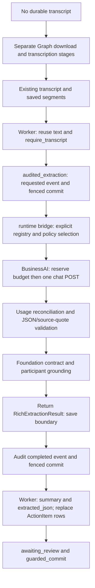

# BusinessAI preparation: existing transcript to summary/actions

This is preparation code, not production AI acceptance. It does not transcribe
recordings, wake Queued jobs, fetch Microsoft data, approve output or send mail.
Defaults remain EXTRACTOR_IMPL=transcript_only and BUSINESSAI_ENABLED=false.

## Call and save chain

Before this branch, main's bridge constructed only transcript_only/mock local
providers; external descriptors were inert. This branch adds BusinessAI settings,
registry construction and bridge selection. The worker already calls the bridge
through services.ai_audit.audited_extraction. The unused legacy
pipeline.extract.get_extractor is not the bridge's factory and is unchanged.
No new analysis trigger is added. Do not use the full worker as an isolated chat
test: even transcript reuse has surrounding Graph/access/enrichment/notification
behaviour. Completed-recording reprocessing is a separate path that downloads
and transcribes again, and rechecks the old result fingerprint before replacement.

The bridge returns a validated RichExtractionResult without database writes.
services.ai_audit writes content-free requested/completed/failed audit events
using the caller's fence. The worker owns result persistence and notifications.
Only summary/action_items are accepted; actions need exact transcript quotes and
existing owner/deadline validation. Human review remains required.

## Controls

Explicit enablement additionally requires HTTPS BUSINESSAI_CHAT_URL, a configured
model and server-side BUSINESSAI_API_KEY. A credential alone never enables calls.
No key belongs in frontend config, source, logs or a chat message.

- BUSINESSAI_MAX_OUTPUT_TOKENS=256 (1–2048): sent as max_tokens.
- BUSINESSAI_MAX_INPUT_BYTES=2048 (1–16384): UTF-8 transcript plus speaker labels;
  reject oversized input rather than silently truncate it.
- BUSINESSAI_TIMEOUT_SECONDS=30 (greater than 0, at most 55): HTTP timeout and
  total POST deadline inside the foundation's existing 60-second deadline.
- BUSINESSAI_MAX_REQUESTS=0 (0–100): monthly UTC admission count cap.
- BUSINESSAI_TOKEN_BUDGET=0 (0–1000000): monthly UTC reserved-token cap.
- BUSINESSAI_LEDGER_PATH: absolute persistent SQLite file outside the checkout;
  parent must exist. Restrict access to the service account. Empty, relative,
  corrupt or unwritable paths fail closed. Zero budgets prohibit sending.

Each send atomically reserves one request and system+transcript UTF-8 bytes,
512 estimated chat-template tokens and the output cap. This is a conservative
admission estimate, NOT a verified vendor tokenizer or monetary guarantee.
Unknown vendor template overhead can exceed it; a reported overrun locks future
sends pending reconciliation. Reservations are not refunded even on success,
error, timeout or cancellation. Unknown charges must not be retried blindly.

The ledger stores only a SHA-256 meeting/input/model/prompt fingerprint, UTC
month, reservation, status and numeric usage. It never stores raw transcripts,
keys, request/response bodies or participant identities. SQLite BEGIN IMMEDIATE
makes admission atomic across instances sharing the file. The same fingerprint
cannot send again across provider instances, worker attempts or month rollover.
Do not delete/replace the ledger to retry an uncertain call.

There is one POST per admitted invocation, no redirects, HTTP retries, streaming,
model discovery, schema request or application fallback. Existing worker retries
remain unchanged; the ledger blocks repeating the same external input. A changed
input/model is a different fingerprint but still consumes the shared budget.

For HTTP 200, usage counters must be nonnegative integers and total_tokens must
equal prompt_tokens+completion_tokens. Missing/malformed usage or usage beyond
the reservation/output cap rejects the result and locks subsequent sends. Usage
is recorded BEFORE content validation: invalid generated JSON still costs its
reservation. Safe INFO logs contain numeric token counts only. Non-200/transport
failures retain reservations with unknown actual usage; they are not assumed free.

This is a SINGLE-HOST preparation ledger, not a vendor-wide budget or distributed
quota service. Independent files, ephemeral containers and multiple replicas can
bypass its scope. Production needs shared durable atomic admission, verified
account-side hard limits, ledger permissions/retention and reconciliation.
Local admission does not enforce vendor RPM/TPM or prove max_tokens enforcement.
No monetary costs are calculated.

## Official evidence checked 2026-10-29

Sources: [Integrations](https://docs.businessai.co.za/developer/access),
[official examples](https://docs.businessai.co.za/app.js?v=20261001e),
[public config](https://api.businessai.co.za/auth/config).

- Quickstart confirms POST /v1/chat/completions, Bearer, model/messages.
  Playground sends max_tokens and stream, with UI range 1–8192. This is interface
  evidence, not verified enforcement for each model. Schema controls are shown;
  actual strict schema behaviour for each runtime remains unconfirmed and the
  adapter does not request it.
- Non-streaming example: choices[0].message.content, finish_reason=stop, usage
  prompt_tokens/completion_tokens/total_tokens. Chat-shaped output does not by
  itself establish valid Meeting Intel JSON or grounded actions.
- Public chat catalog: businessai-chat, mistral-7b-instruct-v0.2,
  glm-4.7-flash:latest, gemma4:e4b, qwen2.5-coder:32b. Actual account grants and
  runtime availability are unconfirmed. businessai-chat explicitly routes vLLM
  first and can fall back to Ollama server-side. Pinning the application model
  does not pin a backend or establish its privacy policy.
- Public concurrency: chat_max_inflight=24, per-subject=4. These are NOT RPM/TPM.
  Key-creation UI defaults are RPM 60, TPM 120000, monthly tokens 10000000.
  Actual key limits, remaining quota and reset windows: UNCONFIRMED.
- Chat 503 example is a plain detail field describing no eligible healthy
  runtime. Exact 400/401/403/408/429/504 error bodies, Retry-After guarantees and
  failed-request billing: UNCONFIRMED. Local mappings are 401/403 configuration,
  429 rate_limited, 408/504/timeouts timeout, other 5xx/transport unavailable,
  other non-200 configuration, malformed usage/output invalid_output. Raw vendor
  errors never enter public failure messages.
- estimated_cost_per_1k_tokens appears in the catalog (router: 0.0008).
  Currency, input/output billing split, taxes, signed actual price, account
  credit and enforceable hard spend ceiling: UNCONFIRMED. Do not turn catalog
  estimates into actual charges or infer price from historic token usage.

## Chat data boundaries: all unconfirmed

The reviewed Integrations examples/public config do not establish these for chat:

- Request/response retention duration: UNCONFIRMED.
- Gateway/provider/debug/trace log content and retention: UNCONFIRMED.
- Deletion mechanism, backup deletion and deletion SLA: UNCONFIRMED.
- Training/fine-tuning/evaluation reuse and opt-out defaults: UNCONFIRMED.
- Processing/storage regions, subprocessors and cross-border transfers:
  UNCONFIRMED. Runtime names mentioning DGX are not contractual regions.

Do not substitute document-extraction zero-persistence claims or Knowledge
retention settings for chat policy. Ask the BusinessAI platform/data-protection
owner for a chat-specific agreement covering all backends/logs/backups, deletion,
training and regions/subprocessors. Ask the account billing administrator for
model grants, RPM/TPM, remaining monthly quota/reset, price/currency, failure
billing and evidence of a hard limit. These are boundary questions, not renewed
permission to use the API.

## Controlled validation gate

Mocks must cover synthetic transcript segments through admission, chat, usage,
JSON/evidence and participant validation to the save boundary. Ordinary tests
must deny real sockets. Mock audit commits are not live database acceptance.
At most one short synthetic request may be sent only after authentication, model
access, documented token limiting and actual quota/budget are verifiable. Use a
persistent ledger, max_requests=1 and explicit token cap. Record numeric usage
and account-visible before/after consumption. Stop without retries on errors or
missing usage. Do not create keys, send real meetings/recordings/PII, deploy,
migrate, start jobs, call Graph or send mail for this validation.

Keep production BusinessAI disabled until chat boundaries and the complete
transcript-to-reviewed-result path are accepted. English-only UI review is a
separate follow-up; no UI copy changes belong in this preparation branch.
